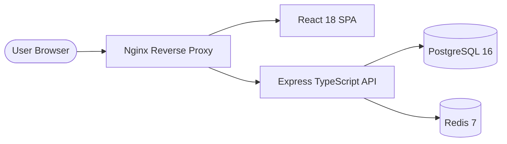

# fullstack-react-node-platform

> Production-grade React & Node.js business management platform with TypeScript, PostgreSQL, Redis caching, and Docker orchestration.

## Overview
This repository provides a modular, scalable enterprise web platform demonstrating clean full-stack architecture. It features a React 18 single-page application built with Vite and Tailwind CSS, coupled with an Express REST API written in TypeScript, backed by PostgreSQL for persistence and Redis for caching.

## Architecture



## Technology Stack
- **Frontend**: React 18, TypeScript, Vite, Tailwind CSS, Lucide Icons
- **Backend**: Node.js 20, Express, TypeScript, Zod, JWT, Helmet, Winston
- **Database & Cache**: PostgreSQL 16, Redis 7
- **DevOps**: Docker, Multi-stage builds, Docker Compose, GitHub Actions CI/CD

## Features
- Scalable monorepo/workspace structure (`client` and `server`)
- Secure authentication with JWT and bcrypt password hashing
- Role-Based Access Control (RBAC) middleware
- Rate limiting and security headers (Helmet.js)
- Comprehensive health check (`/api/v1/health`) and readiness endpoints
- Winston structured JSON logger
- Multi-stage Dockerfiles with unprivileged users

## Project Structure
```text
fullstack-react-node-platform/
├── .github/
│   └── workflows/
│       ├── ci.yml
│       └── deploy.yml
├── client/                 # React Vite frontend
│   ├── src/
│   ├── Dockerfile
│   └── nginx.conf
├── server/                 # Express TypeScript backend
│   ├── src/
│   │   ├── config/
│   │   ├── middleware/
│   │   ├── routes/
│   │   └── index.ts
│   └── Dockerfile
├── docs/                   # Engineering & deployment docs
├── docker-compose.yml
├── .env.example
├── package.json
└── README.md
```

## Local Development

1. Clone and install dependencies:
   ```bash
   git clone https://github.com/manish-lalotra/fullstack-react-node-platform.git
   cd fullstack-react-node-platform
   npm install
   ```

2. Configure environment:
   ```bash
   cp .env.example .env
   ```

3. Run in development mode:
   ```bash
   npm run dev
   ```

## Docker Orchestration

Launch the full stack locally with PostgreSQL and Redis:
```bash
docker compose up -d --build
```
Access frontend at `http://localhost:3000` and API at `http://localhost:5000/api/v1/health`.

## Testing
Run unit and integration test suites:
```bash
npm run test
```

## CI/CD
GitHub Actions workflow `.github/workflows/ci.yml` validates:
- TypeScript compilation and typechecks
- Unit tests via Jest and Supertest
- Docker Compose configuration integrity

## Author
**Manish Lalotra**  
Full Stack Developer & DevOps Engineer  
*Full Stack Developer | DevOps Engineer | Cloud & Infrastructure Engineer*

## License
MIT License. See [LICENSE](LICENSE) for details.
