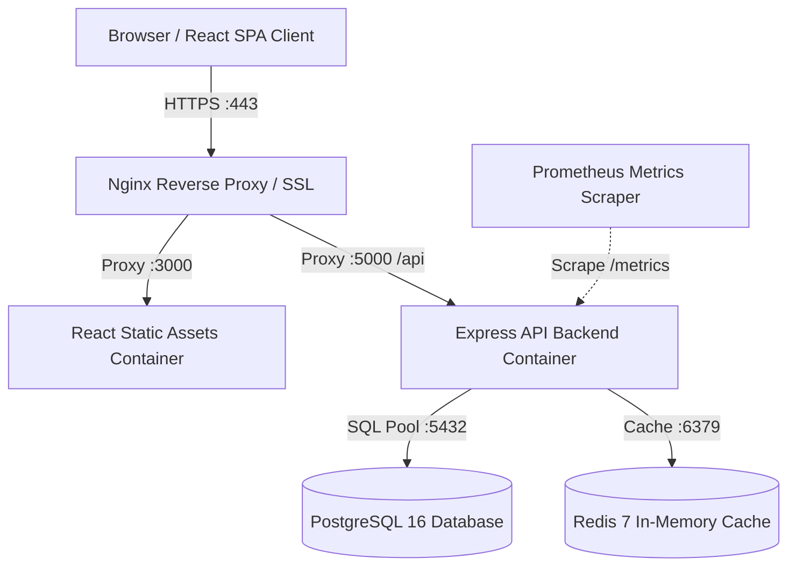

# Architecture Documentation

## System Topology

## Security Controls
- **Helmet.js**: Injects strict HTTP response security headers (CSP, HSTS, X-Frame-Options).
- **CORS**: Restricts API calls to approved origins only.
- **Rate Limiting**: Protects against brute-force attacks on authentication endpoints.
- **Non-Root Containers**: Node and Nginx run as unprivileged system users inside containers.
